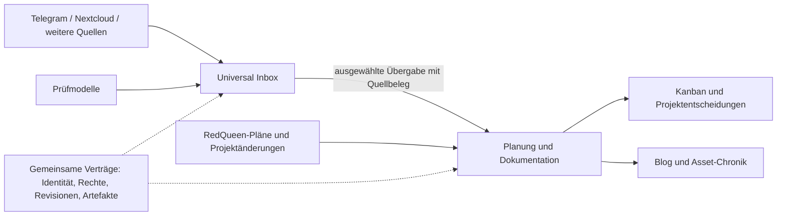

# Abhängigkeitsinventur: Planung/Dokumentation und Universal Inbox

Stand: 26.10.2026. Geprüfter Odysseus-Commit: `80e4a05e82cb9adc3c6c52b99cbfae1a675e4eed`.
Auftrag: Bestandsaufnahme und Plan; Implementierung und Betrieb sind nicht Bestandteil dieser Abnahme.
Der [JSON-Folgeplan](harbour-product-separation-roadmap.json) führt Entscheidungen, Arbeitspakete und Gates.
Dieses Dokument erklärt die Bestandsaufnahme; es ist keine zweite Ausführungs- oder Statusquelle.
[Maschineninventur](evidence/harbour-product-separation-inventory-20261026.json) und
[Planprüfung](evidence/harbour-product-separation-validation-20261026.json) binden die Befunde an Dateien und Prüfungen.

## Ergebnis und Zielbild

**Die Aufteilung ist sinnvoll. Odysseus wird heute aber noch von beiden Seiten als Anwendungsrahmen benötigt.**
Die Planungs- und Knowledge-Kerne sind bereits deutlich besser abtrennbar als ihr aktueller HTTP-/MCP-Zugang.
Das Ziel ist ein eigenständig startendes Plan/Dok-Werkzeug; die Inbox kann zunächst auf dem vorhandenen
Odysseus-Rahmen weiterlaufen. Langfristig braucht auch sie nur die tatsächlich verwendeten Dienste.
Wiederverwendeter Code aus Odysseus bedeutet nicht, dass der gesamte Odysseus-Prozess mitlaufen muss.
Eine Prozentangabe zu ursprünglich erhaltenem Code wäre unbelegt: Hier wurden Abhängigkeiten, keine
Upstream-Git-Abstammung oder produktiven Nutzungsquoten gemessen.

Die Nutzerentscheidung legt zwei Produkte fest:

1. **Planung und Dokumentation:** Projekte, Konzepte, Ziele, Kanban, lesbare Pläne, umgesetzte Bausteine,
   Prüfbelege, Abnahmen und bebilderte Entwicklungsgeschichte. Der Blog wird die Dokumentationsansicht.
2. **Universal Inbox:** Telegram/Nextcloud und weitere Eingänge, Dateien/Text, Extraktion/OCR,
   LLM-gestützte Prüfung, Klärung, Zuordnung und kontrollierte Weitergabe/Export.

**Architekturvorschlag:** zunächst ein Repository mit zwei getrennten Start-/Kompositionsprofilen und
einer kleinen gemeinsamen Bibliothek. Eigene Oberflächen, Datenzuständigkeiten und API-Berechtigungen;
kein obligatorischer dritter Plattformdienst. Getrennte Repositories sind für den ersten Durchstich
nicht nötig. Gemeinsame Bibliotheksnutzung erlaubt keine gegenseitigen Datenbank-Schreibzugriffe.

## Untersuchungsmethode und Grenzen

- Drei abgegrenzte Nur-Lese-Untersuchungen durch `gpt-6-luna`: Planning/Knowledge/MCP, Inbox/Anbindungen,
  RedQueen/Blog. Der Parent hat kritische Aufrufstellen und Aussagen selbst nachgelesen und verantwortet den Plan.
- Statischer Scan über `app.py`, `src`, `routes`, `core`, `services`, `plugins`, `mcp_servers`:
  **1.156 Python-Dateien**, davon **1.153 direkt mit dem vorhandenen AST-Werkzeug geparst**.
  Drei Meldungen entstehen durch UTF-8-BOM; alle drei Dateien lassen sich mit `utf-8-sig` parsen.
  Das ist eine Grenze des vorhandenen Scanners und kein nachgewiesener Python-Laufzeitfehler.
- Der erste Scan zählt 10.476 Importstellen. Die Datenbank wird aus 82 verschiedenen gescannten Modulen,
  `core.auth` aus 29 und `src.auth_helpers` aus 62 direkt importiert. Diese Zahlen beschreiben die aktuelle
  Verflechtung; sie messen weder notwendige Laufzeitimporte noch entfernbaren Code.
- Bedingte/lokale/TYPE_CHECKING-Importe sind mitgezählt. Dynamische Registrierung, Plugins,
  `from`-Symbole und relative Paketimporte benötigen zusätzliche Prüfung vor einer Herauslösung.
- Keine Anwendung gestartet, kein Provider aufgerufen, keine Laufzeitdaten oder Geheimnisse gelesen.
  Produktionsversion, aktive Plugins und tatsächlich genutzte Funktionen sind damit nicht bestätigt.
- RedQueen ist ein separat bearbeiteter, nicht sauberer Arbeitsbaum. Seine Blogquellen sind beobachtete
  Dateien, keine unveränderliche Release-Version. Für eine Übernahme ist eine explizite Übergabe erforderlich.

## Inventur nach Fähigkeit

| Fähigkeit | Heutiger Befund und Beleg | Ziel / benötigte Trennung |
|---|---|---|
| Anwendungsstart | `app.py` komponiert Chat, Uploads, RAG, Planung, MCP und Plugins gemeinsam; `core/database.py:38` bindet globale Pfade und erzeugt den Datenbank-Engine ab Zeile 63. | Zwei explizite Kompositionen. Plan/Dok darf ohne Chat, Inbox-Poller, Modellserver und Telegram starten. |
| Anmeldung und Tokens | `src/mcp_authenticated_dispatch.py:478` benötigt Middleware-Zustand, AuthManager und `core.database.ApiToken`; `src/auth_helpers.py:8` bindet `core.auth`. | Identitäts-/Tokenprüfung als Host-Adapter herauslösen. Bestehende Nutzeridentitäten und Entzug von Rechten erhalten; kein pauschaler Admin-Ersatz. |
| Planning-Definitionen | `src/planning_revision_store.py:88` ist ein Index validierter Definitionen; `src/planning_mcp_service.py:268` liest mit injiziertem Repo-Root. | Plan/Dok. Ziele, Abhängigkeiten und Prüfregeln wiederverwenden; Index nicht mit dauerhafter Schreibautorität verwechseln. |
| Dauerhafte Planung | `src/planning_revision_store.py:2116` speichert atomare Zustandsbilder mit Revisionen und Wiederanlaufprüfung; benötigt Authority-Verträge, keine SQLAlchemy-Datenbank. | Plan/Dok-Kern übernehmen, pro Projekt/Owner scopen. Schreibadapter und anschließendes Lesen nachweisen. |
| Aktuelle Planning-Web-API | `routes/planning_definition_routes.py:273` bindet DATA_DIR, Benutzerauflösung, CSRF/Admin und Issuer; der angenommene Migrationsbestand enthält `harbour-one`/`fuzzy`-Bindungen. | Komposition, Konfiguration und alte Migrationsidentität von allgemeiner Projektverwaltung trennen. Kein globales Ersetzen alter Identitäten. |
| Tatsächlicher MCP-Zugang | `routes/harbour_mcp_routes.py:28` registriert `/mcp`; liest `app.state`, benötigt Auth und kann auf einen Runtime-Adapter ohne durable store zurückfallen. | Bestehenden authentifizierten Vertrag übernehmen und belastbare Lese-/Schreibfähigkeiten zuerst feststellen. Readiness-Antwort allein genügt nicht. |
| Alte Codex-REST-Integration | `routes/codex_routes.py` und `integrations/codex/README.md` beschreiben `/api/codex/*` für bestehende Integrationsfunktionen. Die Untersuchung belegt dort keine passende Planning-Schreiboperation. | Optionaler Legacy-Adapter. Frühere Chat-Annahme, dies sei bereits der geeignete Planning-Schreibpfad, wird korrigiert. Keine Konfigurationsänderung an Codex erforderlich. |
| Neue Harbour-Tool-Fassade | `src/harbour/mcp/dispatcher.py:118` liest bei Heads/Revisionen Census; ab Zeile 434 liefern neue Inbox-Capture/List-Tools Antwortobjekte ohne entsprechende Persistenz. | Nicht als fertige Integration übernehmen. Bestehende echte Dienste anbinden oder unvollständige Tools nicht anbieten; jeden Write zurücklesen. |
| Planning-Kindprozess | `src/planning_process_runtime.py:1` kennzeichnet sich als inaktive Grundlage ohne Produktionsaufrufer; Zeile 58 setzt `PROJECT_ID`. Suche fand keine Konstruktion eines Clients in app/src/routes. | Optionale Isolationsstrategie; kein belegter aktueller Produktionsbedarf und keine Voraussetzung für das erste Plan/Dok-Produkt. |
| Knowledge-Speicher | `src/harbour_knowledge_store.py:421` ist ein eigener SQLite-Store mit Revisionen und authentifizierten Issuern. | Gemeinsame Speicherbausteine wiederverwenden; Journal im Projektbereich, Inbox-Dokumente im Inbox-Bereich. Je Datenbestand ein verantwortlicher Writer. |
| Aktives Knowledge/USI | `src/harbour_knowledge_active_runtime.py:683` benötigt App-Schlüssel, AuthManager, DATA_DIR, gewählte Knowledge-Generation und USI-Konfiguration. | Bootstrap und Lesesicht adapterfähig machen. Dokumentzugriff darf nicht vom optionalen Such-/Vektorindex abhängen. Index bleibt abgeleitet. |
| Universal-Inbox-Dateiablauf | `routes/universal_inbox_routes.py:73`, `src/universal_inbox_items.py:59`, `src/upload_handler.py:305`: Upload-Index, Dateien, Besitzer, Arbeitskopien; Web-Operationen verwenden Datenbanksitzungen. | Inbox. Upload-/Dokumentrepository hinter eigenem Vertrag kapseln; Owner- und Versionsbezug erhalten. |
| Extraktion und OCR | `src/universal_inbox_extraction.py:91`, `src/universal_inbox_ocr.py:27`, `src/universal_inbox_worker.py:121`: Datei entdecken, extrahieren, bewerten und Routing planen. OCR ist optional. | Inbox-Kern plus optionale Format-/OCR-Adapter. Analyse/Dry-run getrennt von tatsächlichem Export. |
| LLM-Datenprüfung | `src/maintenance_model_policy.py:17` pinnt `gemma3:4b`/`local_ollama`; `src/universal_inbox_worker.py:283` erstellt eine begrenzte Anfrage ohne Fallback oder Truth-Write. | Inbox. Mehrere Provider als neue typisierte Adapter; Budget, Datenfreigabe, Timeout und Ergebnisvalidierung erhalten. Modellurteil ist keine menschliche Abnahme. |
| Telegram | `plugins/telegram/live_pipeline.py:102` verarbeitet erlaubte Anhänge in einem Spool und ruft den Inbox-Dry-run; `plugins/telegram/plugin.py:1354` bindet zusätzlich Chat/Agent/Memory-Dienste. | Inbox-Connector für Eingänge herauslösen. Telegram-Chat, PC-Steuerung und Antwortversand sind getrennte optionale Fähigkeiten. Polling und Webhook müssen dieselbe Deduplizierung verwenden. |
| Nextcloud | `src/nextcloud_resumable_scanner.py:53` scannt; `src/universal_inbox_nextcloud_transfer.py:125` ist ein getrennt gegateter Export; `src/nextcloud_knowledge_ingestion.py:790` enthält einen weiteren Knowledge-Pfad. | Inbox-Quell-/Exportadapter. Drei Pfade nicht als bereits einheitlichen Dauerbetrieb darstellen. Übernommene Projektartefakte werden explizit referenziert/übergeben. |
| Harbour-Aufgaben-Inbox | `src/harbour_inbox_service.py:314` vereinigt Clarification, Planning und Knowledge als Lesemodell. H1R-09 beschreibt dies ausdrücklich getrennt von den Quellautoritäten. | Projektentscheidungen/Blocker in Plan/Dok; eingehende Dokumente in Universal Inbox. Gemeinsame Übersicht später optional, mit Aktionen beim jeweiligen Besitzer. |
| Worker-Ausführung | `src/harbour/gateway/coordinator.py:20` nutzt Coding-Backend und Runner-State. Vorhandene Fassade kann Lease/Status melden, ohne damit Worker-Erfolg zu belegen. | Optionales Plan/Dok-Ausführungsmodul. Der erste Blog/Kanban/MCP-Durchstich braucht keinen neuen autonomen Workerbetrieb. Dokumentationsagent kann extern arbeiten. |
| RedQueen-Blog | `07_Produktion/Devblog/README.md:10` führt `content/*.json` als redaktionelle Quellen, Medienindex und datierte Quellenkopien; HTML/Suche sind Ausgaben. `tools/devblog/build_archive.py` erzeugt das Archiv. | Plan/Dok-Dokumentationsansicht. Quellen und Medien über stabile Verweise verbinden; generiertes HTML weder editieren noch als Statusautorität importieren. |
| RedQueen-Projektstatus | `07_Produktion/108_Projektuebersicht.md:112` verweist auf Roadmaps, konkrete Pläne, Code, `abc-run.json` und Reviews. | Zunächst lesende Projektion. Eine spätere Überführung der Planungsautorität braucht eine explizite Quellenzuordnung und genau einen Writer. |
| Allgemeiner Odysseus-Chat und Zusatzfunktionen | `app.py:956` ff. registriert Sessions, Chat, Research, Sprache, Kalender und weitere Dienste. | Für das verlangte Plan/Dok-MVP nicht erforderlich. Für Inbox nur nach tatsächlichem Verbraucher; vor Deaktivierung Nutzung und Abhängigkeiten prüfen. |

Die Zeilen verweisen auf den geprüften Snapshot; Quell-Hashes stehen in der Maschineninventur.
RedQueen-Pfade beziehen sich auf `C:/Users/nkatz/Documents/RedQueen`, alle anderen auf dieses Repository.

## Was an Odysseus bleibt

**Kurzfristig:** Die vollständige alte Anwendung trägt weiter Inbox und Integrationen, während der
Plan/Dok-Kern samt eigener Komposition herausgelöst wird. Gemeinsame Auth-/Storage-Bausteine werden
gezielt weiterverwendet. Ein neuer Plan/Dok-Start darf nicht bloß die bisherige `app.py` importieren.

**Mittelfristig:** Die Inbox erhält ebenfalls eine begrenzte Komposition für Ingest, Review, Connectoren
und Provider. Chat, Modell-Downloadverwaltung, Sprache, Kalender und sonstige Oberflächen werden nur
geladen, wenn ein ausgewählter Ablauf sie benötigt. Beispiel: Sprachnachrichten benötigen Transkription;
Dokumentanhänge benötigen keinen allgemeinen Chat-Agenten.

**Erst nach getrennten Betriebsnachweisen:** Überzählige alte Einstiegspunkte und Abhängigkeiten können
aus dem aktiven Paket entfallen. Physisches Löschen, neue Repositories, Upstream-Abbruch und Umbenennung
aller `odysseus.*`-Verträge sind keine Voraussetzung. Bestehende kompatible API-Namen dürfen bleiben.

## Daten- und Schreibgrenzen

| Daten | Verantwortlicher Bereich | Übergabe |
|---|---|---|
| Originaleingang, Connector-Cursor, Prüfung/Klärung | Universal Inbox | Auswahl mit Herkunft, Quellversion, Freigabe und stabiler Übergabe-ID |
| Projektziel, Plan, Priorität, Abhängigkeiten | Plan/Dok; bis zur Migration bestehende RedQueen-Quelle | Import als Referenz; Writer-Wechsel erst nach geprüftem Übernahmevertrag |
| Ausführungszustand, Claims, Testbelege | jeweilige Projektausführung | revisionsgebundene Beobachtungen, keine Ableitung aus Blogtext |
| Dokumentationsjournal, redaktioneller Text | Plan/Dok-Dokumentation | belegte Änderungsvorschläge; Redaktion und Abnahme bleiben unterscheidbar |
| Medien und Dokumentbytes | Artefaktbesitzer mit Berechtigungen | stabile Artifact-ID/Revision; keine flüchtigen lokalen Pfade als öffentliche Links |
| Suchindex, Kanban, Blog-HTML | abgeleitete Ansichten | wiederaufbaubar; nie zusätzliche Schreibautorität für Plan oder Prüfung |

Übergabevorschlag: `transfer_id`, `idempotency_key`, `source_product`, `source_id`, `source_revision`,
`owner_ref`, `target_project_id`, `payload_ref`, `classification`, `permission_ref`, `created_at`.
Die Annahme liefert eine dauerhafte Zielreferenz; Wiederholung erzeugt kein zweites Vorhaben.
Kein produktübergreifender Direktzugriff auf Tabellen. Retention, Löschung, Rechteentzug und das Verhalten
bereits angenommener Kopien sind vor einer privaten Datenübernahme festzulegen und zu prüfen.

Journalvorschlag: stabile `project_id`/`aspect_id`, optionale `asset_id`/`roadmap_id`/`node_id`,
`event_id`, `source_ref` mit Revision/Digest, `occurred_at` und `observed_at`, Belegtyp und Medienreferenzen.
Plan, Ausführungsstand, Verifikation, Benutzerabnahme und redaktionelle Dokumentation sind getrennte
Dimensionen. Der bestehende Planning-Definitionsvertrag verbietet Runtime-Felder; ein Journal wird daher
nicht durch Einfügen beliebiger `evidence`-/`claim`-Felder in Planning Definition v2 realisiert.

Der Dokumentationsagent beobachtet begrenzte Änderungen und schreibt nachvollziehbare Journalvorschläge.
Er beansprucht keine fremden Implementierungspfade, erfindet keine Prüfergebnisse und nimmt nichts selbst ab.
Für bestehende Blogpfade bleibt die zuständige Redaktion Writer; zwei Agenten schreiben nicht parallel hinein.

## Umsetzungsfolge

Verbindliche IDs, Abhängigkeiten, Prüfkriterien und Gates stehen im [JSON-Plan](harbour-product-separation-roadmap.json).
Alle folgenden Implementierungspakete sind **geplant**, nicht ausgeführt oder abgenommen.

| Paket | Ergebnis | Nachweis vor dem nächsten Schritt |
|---|---|---|
| HPS-01 | Produkt-/Datenverträge und Übergabe; kontrollierter Nachfolger der gepinnten Harbour-Planung | Alte Bindungen bleiben reproduzierbar; neuer Vertrag hat eindeutige Owner, Statusdimensionen und Autoritätswechsel. |
| HPS-02 | Kleine gemeinsame Auth-/Artefakt-/Storage-Schnittstellen und getrennte Startgerüste | Bootstrap mit Testadaptern unabhängig startbar; fehlende Funktionen melden unavailable. Funktionale Inbox-Abnahme erst HPS-06. |
| HPS-03 | Dauerhafte, projektfähige Planning-/Knowledge-API mit echtem MCP-Zugang | Synthetische oder neu Harbour-eigene Projekte schreiben und nach Neustart zurücklesen; RedQueen-Pläne bleiben bis zur expliziten Quellenumschaltung lesend. |
| HPS-04 | RedQueen-Adapter, Blog-/Medienverweise und Kanban-/Chronikansicht | Queen System1 bleibt Zukunft; Scrapper zeigt belegte Historie und offene Abnahmen; kein zweiter Statusstore. |
| HPS-05 | Dokumentationsagent und ein vollständiger Plan→Arbeit→Dokumentation-Durchlauf | Wiederholung ohne Duplikate, korrekte Belege, getrennte Abnahme, Wiedereröffnung und reproduzierbarer Blog-Export. |
| HPS-06 | Eigenständiger Inbox-Kern mit getrennten Telegram-/Nextcloud-Connectors | Verarbeitung ohne Plan/Dok und ohne Chat; Cursor/Deduplizierung, Wiederanlauf und Berechtigungen stimmen. |
| HPS-07 | Austauschbare Prüfmodelle | Fake-Provider und lokaler Adapter bestehen Schema-, Timeout-, Datenschutz- und Budgettests; keine ungefragten Fallbacks. |
| HPS-08 | Geprüfte Inbox→Projekt-Übergabe | Ein Eingang erzeugt genau eine verknüpfte Zielreferenz; Ausfall, Retry, Rechteentzug und Löschregeln sind definiert. |
| HPS-09 | Pilot, Betriebsnachweise und kontrolliertes Ausdünnen des Legacy-Starts | Beide Produkte separat installierbar/startbar; Backup/Restore und Rückweg belegt; Abschaltung nur benannter, ungenutzter Komponenten. |

HPS-03 und HPS-06 können nach HPS-02 parallel mit disjunkten Pfaden bearbeitet werden.
HPS-07 folgt auf den Inbox-Kern. Das Plan/Dok-MVP HPS-03→04→05 wartet nicht auf alle Inbox-Connectoren
oder einen neuen Worker-Gateway. Die Produktübergabe HPS-08 verbindet die beiden fertigen Verträge.

## Erster prüfbarer Durchstich

1. **Queen System1:** `07_Produktion/97_PlanSystem1KI.md` und seine aktuellen Verweise lesend anbinden.
   Die Nummer 97 allein ist wegen mehrfach verwendeter Plannummern nicht eindeutig. Der Dateikopf verschiebt gelerntes
   System1 und LLM-Anbindung ausdrücklich; die Karte bleibt Zukunft/Entwurf mit offenen Entscheidungen.
2. **Scrapper:** vorhandene Katalog-ID, fünf Stufen, Bilder und datierte Quellen verknüpfen. Die bereits
   dokumentierte Historie gilt nicht als vollständige Laufzeitintegration oder Gesamt-/Benutzerabnahme.
3. **Neue kleine Arbeit:** synthetisches Beispiel für Vertragstests; für eine echte Arbeit erst einen
   aktuellen, autorisierten RedQueen-Slice wählen. Plan anlegen, Claim/Umsetzung beobachten, Prüfung
   referenzieren, Abnahme separat zeigen, dokumentieren und dieselbe Karte wieder öffnen können.
4. Den Durchlauf nach Neustart wieder lesen; den Journalimport wiederholen; Blog/Board aus denselben
   Quellen neu aufbauen. Keine Duplikate und keine durch eine Ansicht erfundene Fertigmeldung.

## Offene Entscheidungen und nicht verifizierte Punkte

- Die zwei Produkte sind Nutzerentscheidung; endgültige Namen, URLs und Hosting sind noch offen.
  Sie blockieren die statische Planung nicht. Ein konkreter Rollout wartet auf diese Owner-Entscheidung.
- Welche privaten Nextcloud-Ordner, Telegram-Konten und externen Prüfprovider genutzt werden dürfen,
  wird vor Aktivierung konkret festgelegt. Bereits vorhandene Freigaben sind auf ihren genauen Umfang zu prüfen.
- Aktueller Produktionsstand, tatsächlich aktivierte Funktionen, Integrationsqualität, UI-Verhalten,
  Datenmigration, Live-Provider und Langzeitbetrieb wurden hier nicht geprüft.
- Die bestehende Harbour-Roadmap ist ein gepinnter Migrationsinput. Der dort referenzierte
  `docs/plans/handoffs/abc-open-work-5h-run-20260905.json` fehlt im untersuchten Checkout.
  Alte Akzeptanztexte ersetzen daher keine neue Integrationsprüfung. Die gepinnte Datei wird nicht umgeschrieben.
- Das früher im anderen Chat erwähnte `tools/devblog/workspace/server.py` war bei der aktuellen
  Nur-Lese-Prüfung in RedQueen nicht vorhanden. Der Plan hängt nicht von diesem Prototyp ab.
- Die AST-Inventur belegt keine sichere Löschliste. Vor Entfernung: aktiven Verbraucher, dynamische
  Registrierung, Paketabhängigkeit, Startverhalten und Datenmigrationsbedarf prüfen.

## Zuständigkeit und Übergabe

Der Parent `/root` besitzt ausschließlich den Dokumentationsclaim `HPS-PLAN-20261026` für die fünf
benannten Plan-/Inventurdateien. Die drei Luna-Untersuchungen waren lesend. Die RedQueen- und
Blog-Writer behalten ihre Pfade; eine spätere Implementierung erhält neue, disjunkte Claims.
Nächste technische Arbeit ist HPS-01. Der aktuelle Auftrag endet mit geprüften Planungsartefakten;
Source-Änderung, Commit, Push, private Migration und Deployment folgen daraus nicht.

## Prüfung dieses Plans

Die drei bestehenden Tests des Import-Analysewerkzeugs bestanden. Bei deaktivierter automatischer
Pytest-Pluginladung erschien eine Konfigurationswarnung zu `asyncio_mode`; kein Test schlug fehl.
JSON-Struktur, eindeutige IDs, Abhängigkeitsgraph, Quellenbezüge und unveränderter gepinnter Parent
wurden zusätzlich maschinell geprüft. Ein unabhängiger `gpt-6-sol`-Review fand zwei Abgrenzungsfehler
und zwei ungenaue Quellenverweise; sie wurden korrigiert und im gezielten Nachreview bestätigt.
Der Parent nimmt diese Artefakte als Inventur und Plan ab. Das ist keine Abnahme der geplanten Produkte.
Die abschließenden Dateifingerprints und Prüfergebnisse stehen in der verlinkten Planprüfung.
